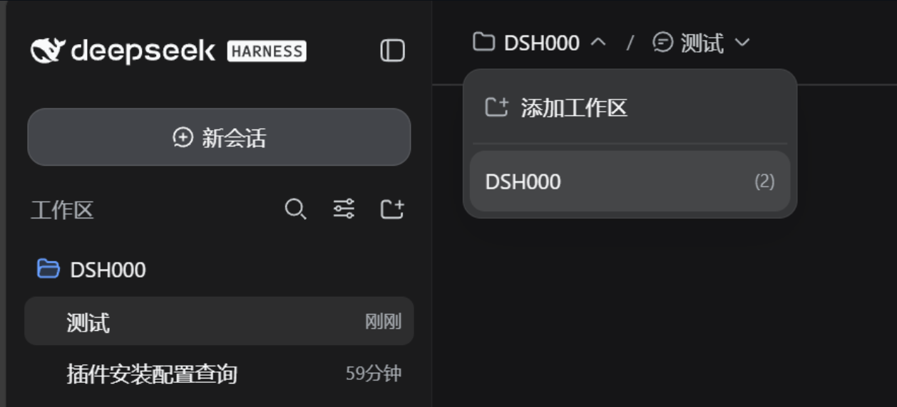
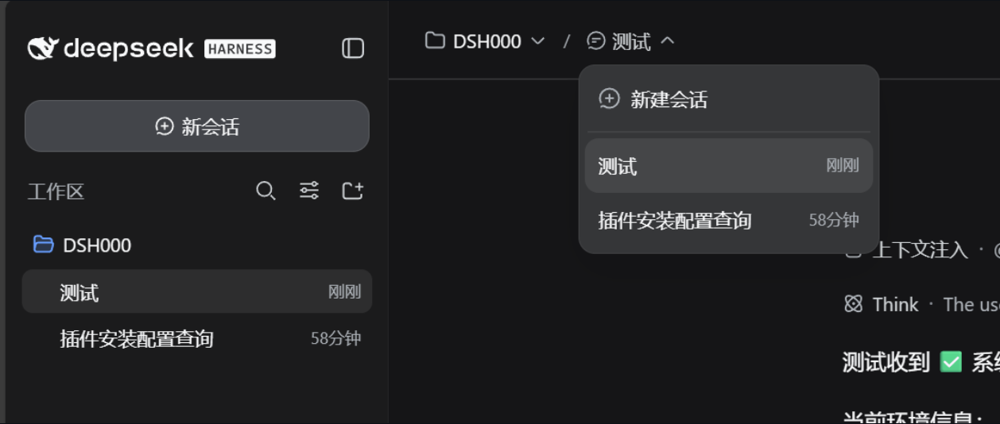
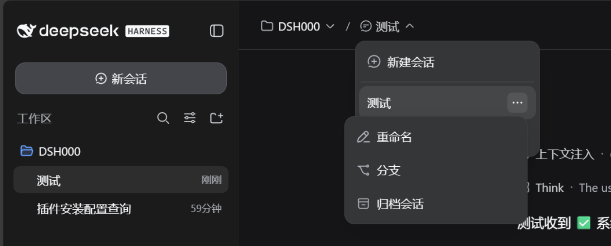
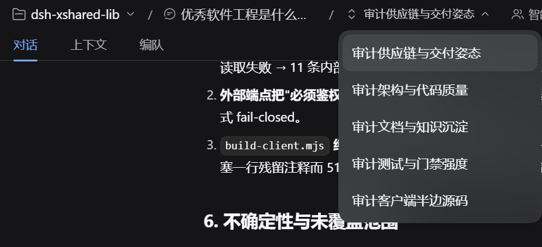

<p align="center">
  
</p>

<p align="center">
  
  
  
  
</p>

<p align="center"><sub><a href="README.md">简体中文</a> · English</sub></p>

<h3 align="center">Topbar "Workspace / Session" breadcrumb + embedded session management (permanent delete / archive), with running / pending-approval status</h3>

<p align="center"><a href="#install"><ins><code>dsh plugin --profile web add github:myeefeng/dsh-session-enhance#v1.6.1</code></ins></a></p>

**Session Enhance** is a **session-topbar enhancement plugin** for [DeepSeek Harness](https://github.com/deepseek-ai/deepseek-harness) — mostly UI enhancement, plus an embedded, toggleable "Session management" component (permanent delete / archive). DSH's native topbar shows only the session title (an ancestry breadcrumb) in the center, while workspace/session switching lives in the left sidebar; when the sidebar is collapsed, every switch costs extra clicks. This plugin puts the switching entry right into the topbar:

- **Workspace dropdown** — all workspaces with their session counts, one-click switch, plus "New workspace" (native directory picker) and delete.
- **Session dropdown** — all sessions of the current workspace with relative timestamps, one-click switch, plus "New session"; the row "more" menu offers rename / fork / archive / **permanent delete**.
- **Breadcrumb on the new-session screen too** — while starting a new session the topbar shows "Workspace / New session", and the session dropdown lists that workspace's history: reach an earlier session while starting a new one, without opening the sidebar.
- **Running / pending-approval status** (matching DSH desktop native style) — the leading side of a session row shows native `StateDot`: **running** is a hollow ring; **pending approval / plan review / answer** is an orange dot, and the row-end swaps the relative time for the matching label (e.g. "Approval").
- **Pinned-session marker** — pinned sessions show a small grey pin at the row end (after the relative time), in both the session dropdown and the hover preview; same wording, icon, size and color as the native sidebar's pinned marker.

All inline row actions reuse native DSH capabilities: rename workspace/session, delete workspace, fork session, archive session — identical to the native sidebar behavior. Permanent delete / archive management comes from the embedded "Session management" component (formerly dsh-chat-manager).

Works on **Windows · macOS · Linux** (DSH Web GUI) — plain JavaScript, no native dependencies, no build step for distribution.

> Verification baseline: **DeepSeek Harness 0.2.1-rc.2** (DSH NEXT Desktop and `dsh web`); 0.2.0-rc.2 also compatible. Other versions are untested.

## Install

`dsh-session-enhance` is a **bundle** — a configuration patch layer distributed as a package (see the [official DSH plugin publishing docs](https://deepseek-harness.github.io/deepseek-harness/develop/basic/publish)). Install it into a profile with `dsh plugin`: it links the package and appends it to `dsh.profile.bundles`:

```sh
# from GitHub (primary channel; v1.6.1 is the current release tag)
dsh plugin --profile web add github:myeefeng/dsh-session-enhance#v1.6.1
```

- **Consider locking a commit**: a GitHub install pulls the repository source, so later pushes don't silently change what you run. To pin the exact content, use `github:myeefeng/dsh-session-enhance#<commit-sha>` (as recommended by the official docs).
- **Local directory / tarball** (development or offline):

  ```sh
  dsh plugin --profile web add ./dsh-session-enhance
  dsh plugin --profile web add ./dsh-session-enhance-1.6.1.tgz
  ```

Then start the Web UI: `dsh web` (or `dsh --profile web`). The first `add` auto-initializes the profile with `@deepseek-ai/dsh-base`.

Uninstall: `dsh plugin --profile web remove dsh-session-enhance` (removes the dependency and the composition layer).

The bundle patch (`cordis.patch.yml`) registers the main plugin row and the embedded "Session management" component row (host routes) automatically. The client half is served on demand: client changes apply after a page refresh; host changes need a restart.

> After installation the plugin manager lists this as "Session Enhance"; the Components view has a toggleable "Session management" component (`dsh-session-enhance/chat-manager`, enabled by default).

## Features

| Capability | Description |
| --- | --- |
| Multi-level breadcrumb | The topbar shows "Workspace / Session", each segment expanding its own dropdown; inside a subagent session it grows to "Workspace / parent / subagent session" (ancestor levels navigate back). |
| Per-level icon fallback | Levels fall back to icons only when the topbar genuinely runs out of room: **the whole row overflows → every level collapses** (so it is never cut off at the window edge), and **a level squeezed below a readable width** (visible label < 80px ≈ 5 CJK characters) → that level collapses. Icons are per level (workspace = folder, plain session = session glyph, subagent = the native switcher's up/down chevrons); the full title stays in the tooltip and the accessible name. A level whose title merely exceeds its own cap keeps the truncated text — that carries more information than an icon. The `/` separators always stay, so the hierarchy remains readable in icon form. |
| Workspace dropdown | Workspace list (session-count meta), New workspace (native directory picker), row "more": rename / delete workspace. |
| Workspace hover preview | Hovering a workspace row expands that workspace's session list to the right (pinned first, current session highlighted, relative time at the row end, status dot at the row start); click a row to switch. Moving away closes it. It flips to the row's left when there is no room on the right, and stays inside the viewport in narrow windows. Opening has a 120ms intent delay (skimming down the list does not pop panels on every row); closing has a 200ms grace period (crossing the gap into the panel does not close it). Pointer-driven; keyboard users keep using the session dropdown. |
| Session dropdown | Session list of the current workspace (relative-time meta), New session, row "more": rename / fork / archive session, **permanent delete** (calls the embedded `dsh-session-enhance/chat-manager` delete route). The leading side shows native `StateDot` status (running hollow ring / pending-approval orange dot); for pending approval the row end shows the matching label (e.g. "Approval"). Pinned sessions carry a small grey pin at the row end (see "Pinned-session marker"). |
| Pinned-session marker | A pinned session shows a grey pin at the row end in **both the session dropdown and the hover preview**, placed right after the relative time — matching the native DSH sidebar `PinnedIndicator` item by item: a non-interactive `role="img"` span (`aria-label`/`title` = "Pinned", taken from the native `row.pinned`), containing `IconPinFillRegular` at 14px, colored `--dsw-alias-label-caption`, in a 16×20 box. The row itself remains the only action target. Hovering the row hides the pin in favour of the "more" button (same policy as the native `.sessionRow:hover .pinIndicator`, because the more button lands exactly where the resting pin sits); rows in the hover preview have no "more" button, so the pin stays visible there. |
| Session management (embedded component) | Permanently delete sessions (with confirmation), archive sessions, and an "Archived sessions" settings page (search / unarchive / permanently delete). See "Embedded component: Session management" below. |
| Breadcrumb on the new-session screen | While a new session is being started the host suppresses the topbar title (`hideChrome`), and `conversation.header.leading` is the seat it reserves for "global navigation before the Session title" (scope=root, always rendered) — so the new-session topbar is otherwise empty. The plugin registers there too: "Workspace / New session", with the workspace's session history in the session dropdown — reach an earlier session while starting a new one, without opening the sidebar. Mutually exclusive with the in-session breadcrumb (it does not render once a real session is open), so the topbar never shows two. |
| Native-consistent interactions | The dropdown is a self-drawn layer that reuses the native menu tokens (`--dsw-elevation-prominent`, `--dsw-radius-lg`, `--dsw-menu-surface-fill` + `--dsw-menu-backdrop-filter`, hover fill `--dsw-alias-interactive-bg-hover`); its row metrics are min-height 40 / padding 8·10 / 14px·22px (matching the native `AccountMenu` `[role=menuitem]`; the native `Menu.module.css` is more compact and this plugin does not follow it). The more menu and rename/delete dialogs use the native `Menu` / `Modal` / `Button` / `Input` (autoFocus, select-all, IME-safe Enter, duplicate workspace-name check, error rows). |
| Shared lifecycle | The more menu closes with its owning dropdown (outside click / Escape / selection / switching) — no orphan menus. |
| Bilingual | Built-in zh/en dictionaries that follow the DSH language switch live. |

## Screenshots

**Session dropdown open** — switch sessions, create new:



**Session "more" menu** — hover the row end for rename / fork / archive:



**Workspace dropdown open** — switch workspaces, new workspace:


**Subagent ancestry crumb** — when the session is a subagent, the breadcrumb grows its parent chain; click the last level to switch between sibling subagents:



## Usage

After installation, open any session — the topbar center shows the "Workspace / Session" breadcrumb:

- Click the **workspace** side: the workspace dropdown opens ("New workspace" on top).
- Hover a **workspace row**: its session list expands to the right (click a session to switch); it closes when the pointer leaves, and on list scroll.
- Click the **session** side: the session dropdown opens ("New session" on top).
- Hover a row: the "More" button appears at the row end (rename / fork / archive / permanent delete, per row type).
- Leading status dot: hollow ring = running; orange dot = pending approval / plan review / answer (the row end then shows the matching label).
- Select a row to switch; click outside or press `Esc` to close the dropdown.

## Relationship with DSH

This project is built on the official [deepseek-ai/deepseek-harness](https://github.com/deepseek-ai/deepseek-harness) and is a **community plugin** — not an official DeepSeek product. Everything it shows is DSH's own data and UI, re-arranged; no system source changes.

## Development

- **`index.js`** — host half: minimal no-op (a pure UI plugin; all logic lives in the browser half).
- **`lib/client.js`** — browser half (UMD, registered into DSH `clientModules`). Structure, top to bottom:
  1. Local utilities: style injection / timers.
  2. **Bilingual dictionaries** (`BST_ZH` / `BST_EN`) — registered into `ctx.locale`, following the language switch; `bstT()` falls back gracefully.
  3. **Self-drawn dropdown** `BstList` — native menu styling and tokens; viewport-aware positioning; outside close on `click` (not mousedown/pointerdown: those dispatch before `click`, unload the list first and swallow inline clicks). It also carries the optional hooks used by the workspace dropdown (`onRowHover` / `onRowLeave` / `onScroll` / `panelRef`).
  4. **Hover flyout** `BstSideList` — the per-workspace session list that expands to the right of a hovered workspace row (see the quick reference below).
  5. `WorkspaceTitleBreadcrumb` — registered into `conversation.session.header.actions` (`order: -40`, leftmost in the topbar); per-level icon fallback (a level drops its text only once the topbar squeezes it below `ICONIC_TEXT_FLOOR` of visible label width; recovery uses a header-width hysteresis, so it never flaps); the more menu shares the dropdown lifecycle; rename/delete use native Modals; running / pending-approval status is rendered with native `StateDot` from `uiSession.sessionStatus`.
  6. `apply(ctx)` — style injection + slot registration with `inject: ['slots','workspaces','sessions','uiWorkspace','locale','shortcuts']` (declaring the service dependencies matters: if `apply` wins the race, `undefined` handles get captured permanently and every action dies silently while the UI still looks perfect). The session-status source `uiSession.sessionStatus` (`Map<sessionId,{running,pendingInteraction,completionUnread}>`) is absent on some host generations, so it is read lazily via `ctx.get` and degrades to "no marker" instead of being added to `inject`. At the end it calls `registerChatManagerClient` to register the embedded session-management client features.

Quick reference:

- **Add a row action** — add an entry to the `actions` array of `wsListItems` / `ssListItems` (`{ id, label, icon?, danger?, action }`).
- **Add copy** — add a key to the `BST_ZH` / `BST_EN` dictionaries.
- **Tweak dropdown styles** — edit the `.bst-item*` rules in `insertStyle` (tokens match the native Menu).
- **Change the icon-fallback threshold** — the threshold is `ICONIC_TEXT_FLOOR` (≈5 CJK characters wide): a level falls back to its icon only when its label is truncated *and* its visible width is below it, or when the whole row overflows. Two traps: (1) do not use "the title exceeds this level's `max-width`" as the predicate — that also matches in a wide window (a long title exceeds the cap by nature) and the UI would turn into icons everywhere; (2) do not assume the label always gets squeezed — topbar containers are not shrinkable by default, and the overflow shows up as clipping at the window edge instead (see the `has(.bst-crumbs)` rule that makes them shrinkable).
- **Add another chain level** — change `bstSessionChain` (data) only; the render path is one shared block per level, with the icon picked by `node.subagent` (subagent = up/down chevrons, otherwise the session glyph), so no chain length can produce a level without an icon.
- **The dropdown must be portaled into `document.body`** — rendered in place inside the topbar slot it sits in the header's stacking context, so page content (including a third-party plugin's injected `复制` button) paints over it, and the app shell's sidebar column can cover its first row. The native `Menu`'s `portal: true` exists for the same reason.
- **Hover flyout (workspace → session list)** — `BstSideList` and the main list are **two** portal siblings with independent positioning: the list anchors to the workspace button, the flyout anchors to the hovered row's rect (`rect.right + 6`; flips left when it does not fit, and is clamped into the viewport when neither side fits). Four traps: (1) the flyout must take part in `BstList`'s outside-click check through `panelRef`, otherwise clicking the flyout's padding or scrollbar counts as an outside click and dismisses the whole dropdown (the row click itself is never lost: React 18 attaches portal listeners on the portal container, which fire before the `document` listener); (2) the flyout is positioned from a row rect, so it must close as soon as the list scrolls (`onScroll`); (3) the open/close timers (120ms intent / 200ms grace) must be cleared on list close, scroll and unmount, otherwise a stale `setState` fires on a closed list; (4) row hover uses **`mouseover`, not `mouseenter`** — only the bubbling `mouseover` can tell that the pointer moved from the row body onto the row's "More" button, which must hide the flyout (`mouseenter` fires once on entry and never re-fires). The flyout reuses `.bst-item`, but `.bst-side` has to override the "hide meta on hover" rule — its rows have no "More" button, so the relative time must not disappear.
- **Do not reuse the native wording for action rows** — "mobile pocket" plugins (measured: `dsh-pocket` 2.11.0 `hideWsEntries`) scan every `[role=menuitem]`/`[role=option]`/`li`/`button`/`a` and hide the ones whose text **exactly** matches `添加工作区` / `Add workspace`, with a `MutationObserver` that keeps newly inserted nodes hidden too. Reusing the native label made that row vanish from our dropdown; keeping our own wording (`新建工作区` / `New workspace`) avoids it.

### Embedded component: Session management (`dsh-session-enhance/chat-manager`)

Permanent delete / archive management needs always-present host routes (`/plugins/dsh-session-delete/*`), so [dsh-chat-manager](https://github.com/)'s **full functionality** is embedded as a **required, toggleable component** of this plugin (display name "Session management"), rather than an external dependency:

- **Host half** (`lib/components/chat-manager/index.js` + `host/`, reusing dsh-chat-manager's `delete-session` / `archive-manager`): routes for permanent delete and archive, gated by the component-row toggle.
- **Client half** (merged into the main `lib/client.js` as `registerChatManagerClient`, loaded with the main plugin): the sidebar session-menu "Delete permanently" item + delete confirmation dialog, the sidebar header "Archived sessions" entry, and the "Archived sessions" settings page (search / unarchive / permanently delete).
- Registered as a toggleable row in `package.json` and `cordis.patch.yml` (`id: dsh-bst-chat-manager`, `name: dsh-session-enhance/chat-manager`), **enabled by default**, toggleable in DSH's Components view.
- **Architecture note**: DSH serves exactly **one** `./client` bundle per npm package (resolved by package name from `dsh.client` + `exports["./client"]` via `dsh-client-modules`); a sub-component cannot carry its own client half, so chat-manager's client features are merged into the main client and registered in the main `apply`. The component row carries only the host routes (toggleable).
- **Copyright**: the component code is copied from dsh-chat-manager (MIT, © WSL043), with attribution and license retained.

> Tip: if your profile already installs `dsh-chat-manager` separately, this embedded component registers the **same-path** delete/archive routes — keep only one to avoid duplicate-route conflicts.

## Acknowledgments

Thanks to [DeepSeek Harness](https://github.com/deepseek-ai/deepseek-harness) and the DeepSeek AI team — the agent, models, tools, sessions, Web UI and plugin ecosystem all come from this project; to [Cordis](https://github.com/cordiverse/cordis) for the plugin foundation; and to the [Koishi.js](https://koishi.chat/) community for its long-standing plugin practices, tooling and experience.

## License

[MIT](LICENSE) — fully open source and free.

Session Enhance is a community plugin for DeepSeek Harness — **not a DeepSeek official product**.
